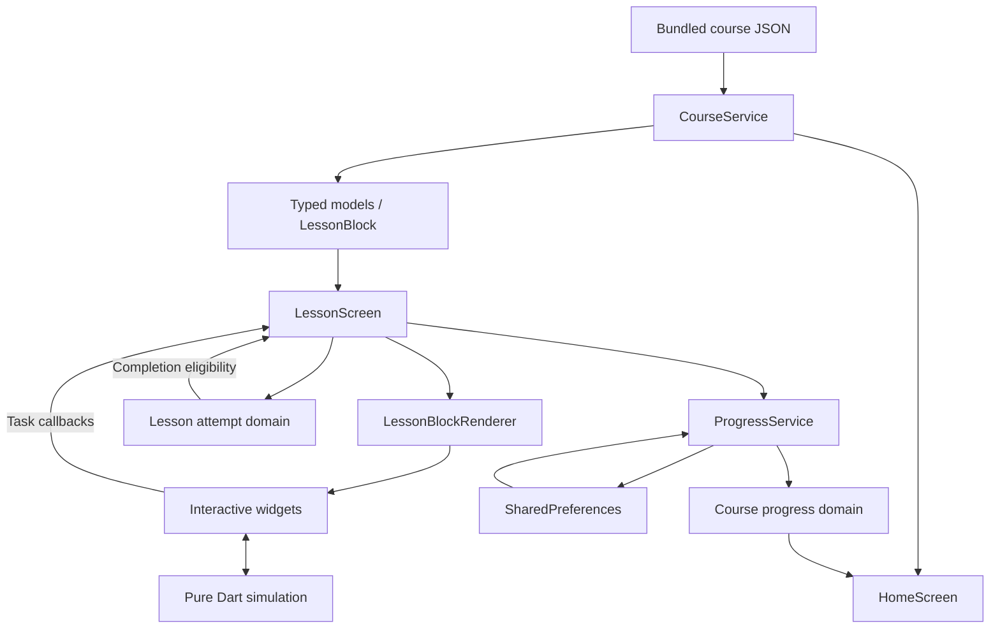
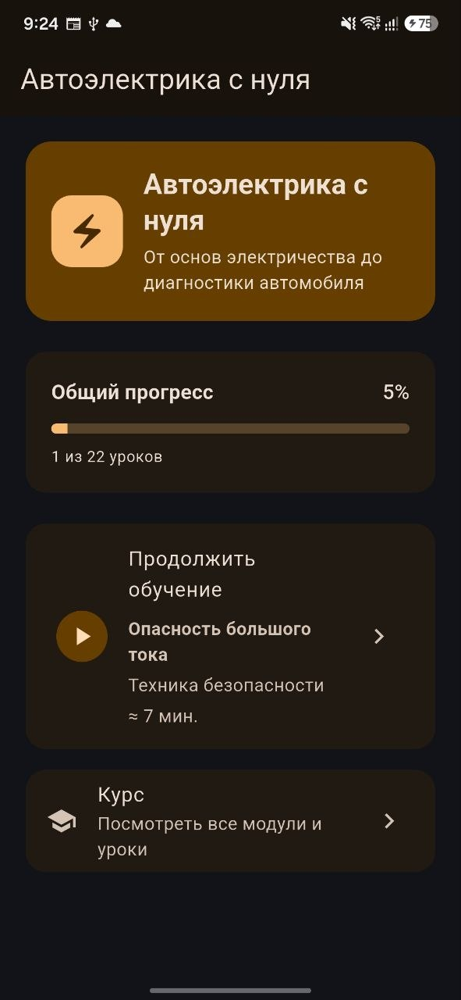
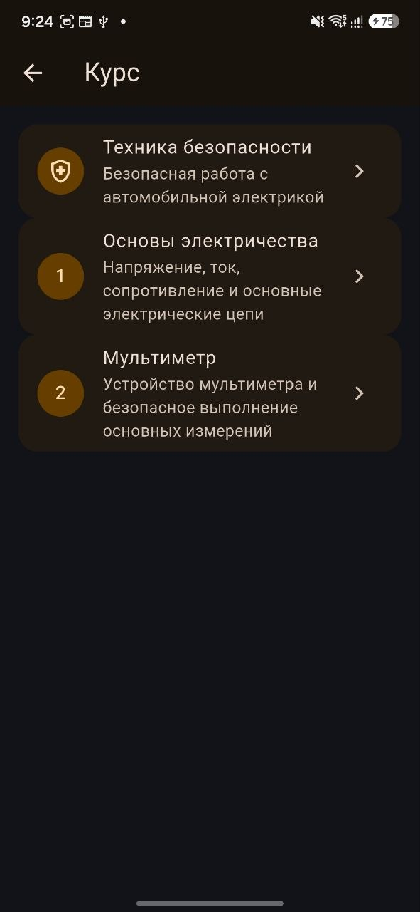
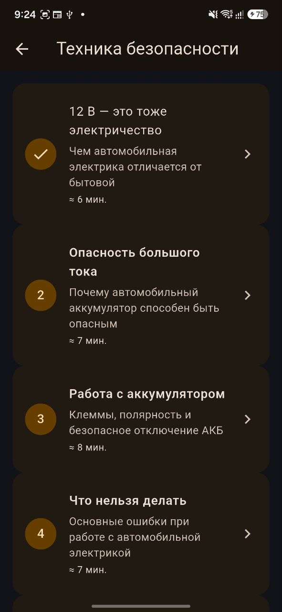
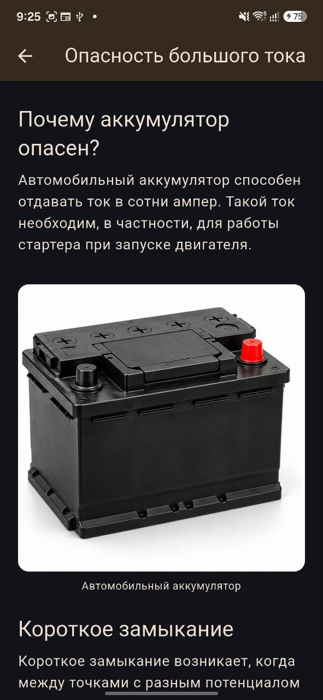
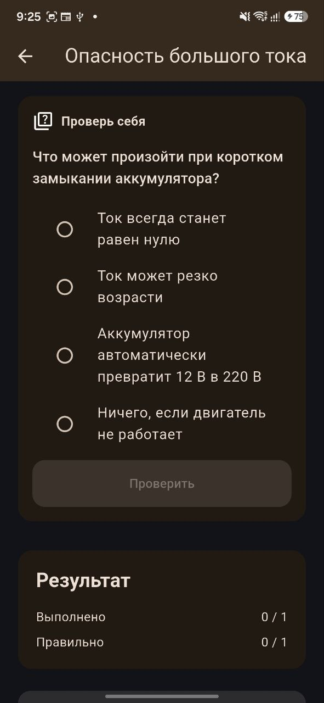
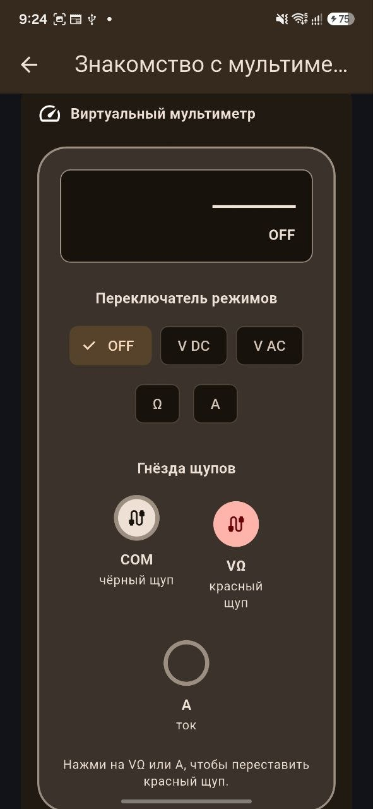
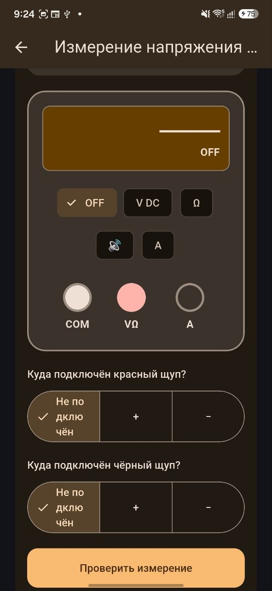

# Автоэлектрика с нуля

**Auto Electrician Learning App** — интерактивное Flutter-приложение для
последовательного изучения автомобильной электрики с начального уровня.
Портфолио-проект для начинающих: теория закрепляется расчётами, измерениями
и диагностикой.

Техническая версия **0.1.0-rc.1+2** — Android RC1 для локальной проверки.
Реализованы этапы курса R7–R17 и отдельный практикум R18; R19.2A устраняет
замечания технического аудита. Статус готовности к выпуску — **NOT READY**:
полная физическая приёмка текущего baseline, TalkBack и независимое профильное
ревью содержания не завершены. Приложение не опубликовано; Google Play
публикация не входит в текущий scope. [Проверка R19.2A](docs/verification/R19_2A_UI_DOCUMENTATION_FIXES.md).

## Курс и возможности

Курс содержит **14 учебных модулей и 132 урока**:

1. Техника безопасности.
2. Основы электричества.
3. Мультиметр.
4. Электрооборудование автомобиля.
5. Чтение автомобильных электрических схем.
6. Диагностика электрических неисправностей автомобиля.
7. Автомобильная электроника и электронные системы управления.
8. Компьютерная диагностика автомобиля.
9. Запуск, зарядка и паразитное потребление.
10. Автомобильная проводка, разъёмы и ремонт электрических соединений.
11. Автомобильный осциллограф и анализ сигналов.
12. Кузовная электроника и системы комфорта.
13. Электронные системы безопасности: ABS, ESP/ESC и SRS.
14. Гибридные и электрические автомобили.

Темы: безопасность, напряжение/ток/сопротивление, закон Ома, последовательные
и параллельные цепи, измерения, поиск обрыва и базовая диагностика автомобиля.

Уроки объединяют текст, иллюстрации, предупреждения, вопросы, расчётные
задачи, практические упражнения и итоговые тесты. JSON-контент отделён от
интерфейса и пользовательского прогресса.

Принцип обучения: теория → пример → интерактивное задание → измерение или
диагностика → проверка ответа → закрепление.

**«Практика диагноста» — отдельный раздел с 18 диагностическими кейсами**,
не пятнадцатый учебный модуль. В нём нужно выбрать проверки, собрать журнал
наблюдений, сопоставить гипотезы с доказательствами и обосновать заключение.
Сценарии используют синтетические данные; угадывание детали само по себе не
даёт зачёт. Прогресс практикума не изменяет completion 132 уроков.

### Интерактивные тренажёры

- Электрические цепи: замкнутая/разомкнутая цепь, последовательное и
  параллельное соединение, влияние обрыва на потребителей.
- Виртуальный мультиметр: режимы, входы, подключение щупов и типичные ошибки.
- Измерения: напряжение аккумулятора и обратная полярность, сопротивление
  провода, прозвонка, поиск обрыва и падение напряжения под нагрузкой.
- Измерение тока: выбор режима и входа, ошибки подключения и симуляция
  перегорания предохранителя мультиметра.
- Диагностика: измерения в неисправной цепи, сохранённые результаты и выбор
  диагноза по полученным данным.
- Учебный осциллограф: синтетические сигналы, шкалы напряжения и времени,
  trigger/capture и проверка выбранной настройки.

Есть светлая и тёмная темы. Widget-тесты проверяют узкие компоновки и
увеличенный текст. Исторический [Android smoke R6](docs/verification/R6_6.md)
относится к раннему baseline и не подтверждает физическую приёмку всего
нынешнего курса и практикума.

## Offline-first и прогресс

Установленный курс работает без интернета, сервера и учётной записи.
SharedPreferences хранит идентификаторы завершённых уроков локально.
Home показывает общий прогресс и следующий незавершённый урок;
список уроков модуля отмечает завершённые уроки.

Для обычного урока нужно правильно выполнить все оцениваемые задания;
для итогового теста — ответить на все задания и набрать заданный проходной
балл. В итоговом quiz ответы проверяются одной общей кнопкой; после проверки
для новой попытки нужен retry. Завершение подтверждается отдельной кнопкой.
Ответы урока и quiz сохраняются при прокрутке текущего экрана, но после выхода
черновик и история баллов урока не восстанавливаются.

Для каждого кейса практикума локально сохраняются лучший балл, факт прохождения,
число завершённых попыток и время последнего завершения. Полный журнал,
гипотезы и незавершённый черновик остаются только в текущей сессии.

Запись completion выполняется последовательно между экземплярами сервиса.
Экран сообщает об ошибке записи и допускает повтор; во время записи
защищается от повторного завершения и пользовательского back.
Ошибки чтения прогресса отображаются с возможностью повторить загрузку.
Автоматические тесты проверяют пересоздание сервиса и хранилища; native
перезапуск и обновление APK текущей версии ещё требуют физической проверки.

Android applicationId: `com.dauletserikson.autoelectrician`.
После смены старого development ID `com.example.electrician` его локальный
прогресс автоматически не переносится. Удаление приложения/его данных
удаляет локальный прогресс; облачного восстановления нет.
Для обновления без удаления данных нужны прежний applicationId и совместимая
подпись. При несовместимой подписи нельзя обходить проблему удалением приложения,
если требуется сохранить прогресс.

## Архитектура

`CourseService` загружает bundled JSON в типизированные модели.
`LessonBlock` — sealed-иерархия: неизвестный тип и отсутствие обязательных
данных дают явную parsing/validation ошибку. `LessonBlockRenderer` выбирает
widget по subtype. `LessonScreen` управляет ответами, completion и записью.
Расчёты и диагностические правила вынесены в pure Dart `simulation/`.
В `domain/` находятся оценка попытки и агрегация прогресса курса.
`ProgressService` обслуживает локальный прогресс уроков. В `practice/` находятся
строгие определения кейсов, журнал/оценка доказательств, route controller и
изолированный repository результатов. Backend и framework state management отсутствуют.



```text
lib/
  main.dart                  AutoElectricianApp
  models/                    typed content and summary models
  domain/                    lesson attempt, course progress
  simulation/                pure Dart electrical/diagnostic rules
  services/                  CourseService, ProgressService
  practice/                  definitions, evidence engine, result repository
  screens/                   Home, Course, Module, Lesson, Practice
  widgets/lesson_blocks/     interactive block widgets
  widgets/lesson_block_renderer.dart
  theme/                     Material light/dark themes
assets/course/               modules.json, stage_0–stage_13, 132 lessons
assets/practice/             catalog.json, cases/dp01–dp18
assets/images/               battery illustration and authored course diagrams
assets/branding/             approved launcher source artwork
test/                        models, domain, simulation, services, widgets
docs/verification/           completed-task verification records
docs/roadmap/                engineering plans/history
tools/                       launcher, course/asset generation and audits
```

## Технологии и платформы

Flutter, Dart, Material Design, JSON, shared_preferences и flutter_test.
Dart package — `electrician`.

Основной целевой клиент — **Android**. Наличие iOS, macOS, Windows и web
runners не означает проверенную поддержку этих платформ.
Проверенная среда: **Flutter 3.47.5 stable, Dart 3.13.4**.
SDK constraint проекта: `^3.13.4`. Для Android нужны Android SDK и совместимый
JDK; Java/Kotlin компилируются с JVM target 17.

## Запуск и проверки

```bash
git clone https://github.com/DauletSerikson/auto-electrician-learning-app.git
cd auto-electrician-learning-app
flutter pub get
flutter run
```

Выберите подключённое Android-устройство или эмулятор. Перед завершением
изменений:

```bash
dart format lib test
flutter analyze
flutter test
git diff --check
```

Ожидаемый результат анализа — `No issues found!`.
Тесты проверяют parsing/validation, реальные course assets и их
согласованность, domain completion/progress rules, физические модели,
ошибки и concurrency storage, ввод в симуляторах, навигацию/сохранение
экранов, узкие компоновки и полный app smoke путь Home → Course → Module →
реальный урок → completion → обновление прогресса. App smoke использует
widget test и изолированный SharedPreferences platform fake; физическую
Android проверку он не заменяет. Фактические проверки — в
[docs/verification](docs/verification/).

GitHub Actions: один job с Flutter 3.47.5 stable выполняет `flutter pub get`,
`flutter analyze`, `flutter test` при push в main/release/r6-readiness,
pull request и ручном запуске. [Workflow](.github/workflows/flutter.yml).
Исторический [CI для ca1262e](https://github.com/DauletSerikson/auto-electrician-learning-app/actions/runs/38069846487)
завершился успешно (R6, 600 тестов); подробности — в [R6.7](docs/verification/R6_7.md).
Удалённый результат CI для текущей ветки R19 не проверен. Push в feature/fix
ветки сам по себе не входит в указанный фильтр; сборка Android в workflow
не настроена. Исторический проект release notes: [v0.1.0](docs/releases/v0.1.0.md).

## Android APK

```bash
flutter build apk --debug
flutter build apk --release
```

Release APK: `build/app/outputs/flutter-apk/app-release.apk`.
Версия: `0.1.0-rc.1`, versionCode: `2`.

Release-mode APK использует **debug signing** для portfolio/sideload
демонстрации. Это не production-store signing и не заявка на готовность
к Google Play. Keystore/credentials не хранятся в репозитории.

## Скриншоты и демонстрация

Исторические реальные кадры R6 версии 0.1.0+1 с SM-S931B (Android 17), тёмная тема.
Home и список уроков показывают сохранённый прогресс: 1 из 22 уроков.
Они не отражают нынешние 14 модулей/132 урока/18 кейсов и исправленный Home.
Измерительные тренажёры показаны в исходном состоянии OFF.

| Home и прогресс | Модули курса | Уроки модуля |
| --- | --- | --- |
|  |  |  |

| Теория и иллюстрация | Вопрос урока | Виртуальный мультиметр |
| --- | --- | --- |
|  |  |  |



Описание кадров и оставшиеся дополнительные снимки:
[docs/screenshots](docs/screenshots/README.md).

## Ограничения

- Симуляторы — специализированные учебные модели, не универсальный solver.
- Приложение не заменяет документацию конкретного автомобиля и
  профессиональное диагностическое оборудование.
- Нет авторизации, синхронизации, analytics, unlocking и восстановления
  незавершённой quiz/practice session после выхода. Полная история попыток
  не сохраняется; summary завершённых кейсов практикума сохраняется.
- Итог R19.1 — NOT READY. Физическая QA актуального Android APK, upgrade без
  потери данных и TalkBack не завершены.
- Независимая электротехническая экспертиза схем, кейсов, SRS/ABS/HV
  и процедур измерений не подтверждена; саморевью и тесты её не заменяют.
- Продвинутый accessibility audit и другие платформы ещё не проверены.

## Развитие проекта

Завершённые этапы: R1 stabilization, R2 typed lesson blocks,
R3 simulator/domain separation, R4 simulator correctness,
R5 progress reliability/domain rules; R7–R17 добавили учебные модули,
R18 — диагностический практикум. R6 содержит историю подготовки портфолио,
R19 — аудит и устранение подтверждённых замечаний перед дальнейшей приёмкой.
Планы сохранены в [docs/roadmap](docs/roadmap/) как история разработки;
они не являются пользовательским руководством.

Текущий приоритет — стабильность, приёмка на Android, доступность и профильное
ревью. Новые функции и дальнейшие этапы требуют отдельных задач.

## Лицензия и artwork

Код и документация — [MIT](LICENSE), copyright 2026 Daulet Serikson.
Утверждённые владельцем launcher и battery artwork сгенерированы специально
для проекта с помощью OpenAI image generation. По заявлению владельца,
сторонние исходные изображения и логотипы не использовались.
Происхождение: [launcher](assets/branding/README.md),
[battery](assets/images/README.md). Исключительные права на AI-generated
artwork не заявляются; MIT не служит гарантией таких прав.
Dependencies распространяются по своим лицензиям.

## Автор

**Daulet Serikson** · GitHub: [DauletSerikson](https://github.com/DauletSerikson)
