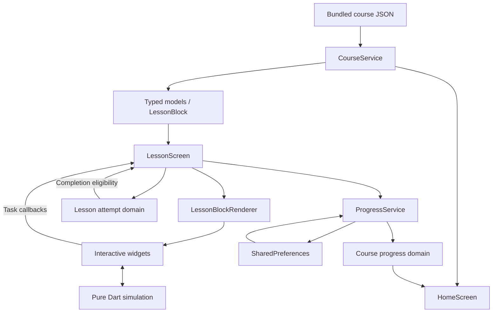
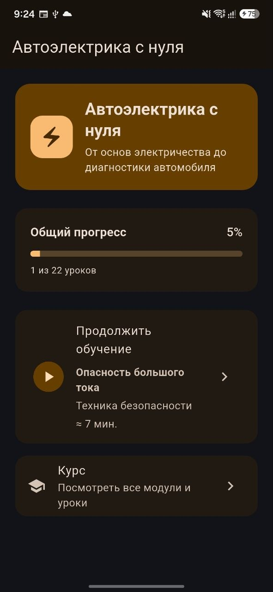
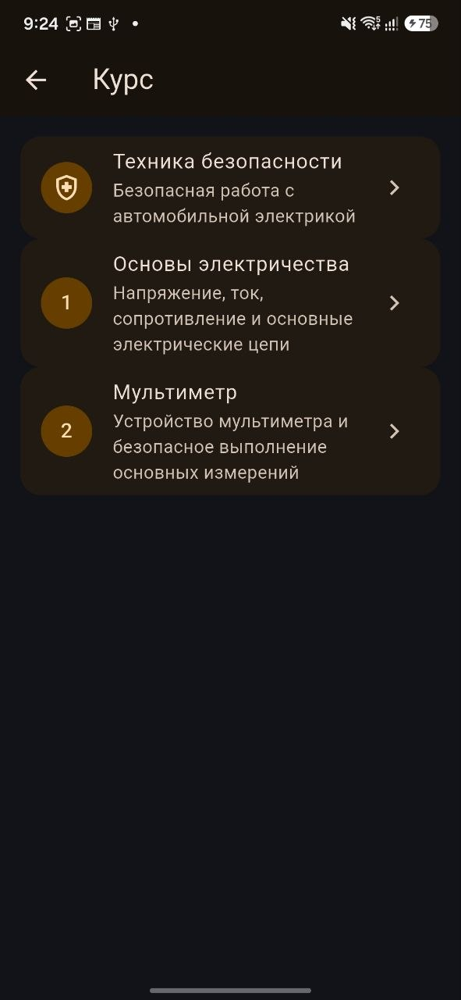
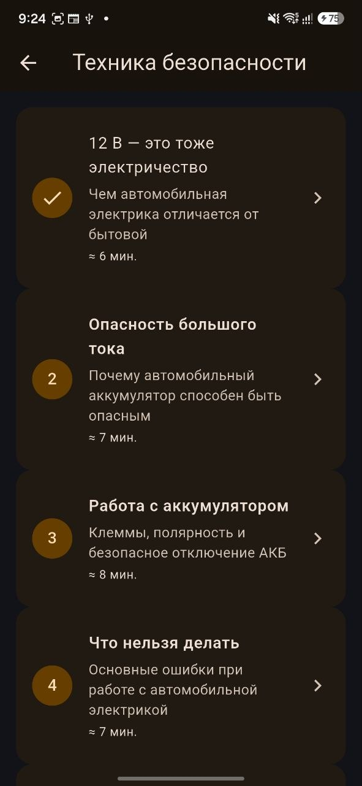
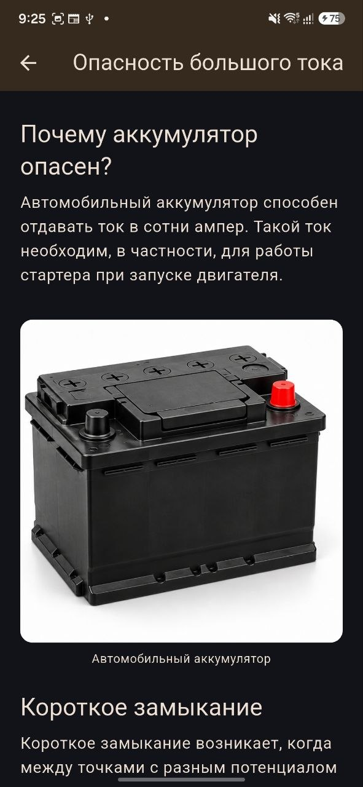
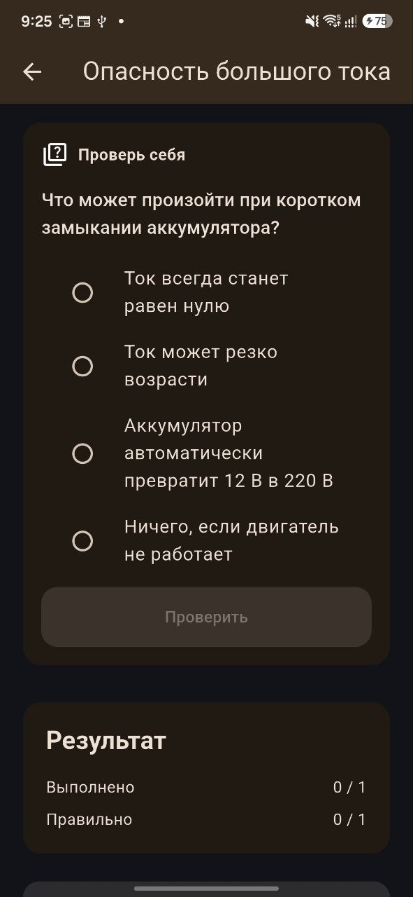
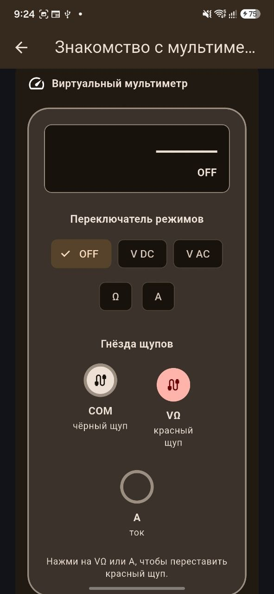
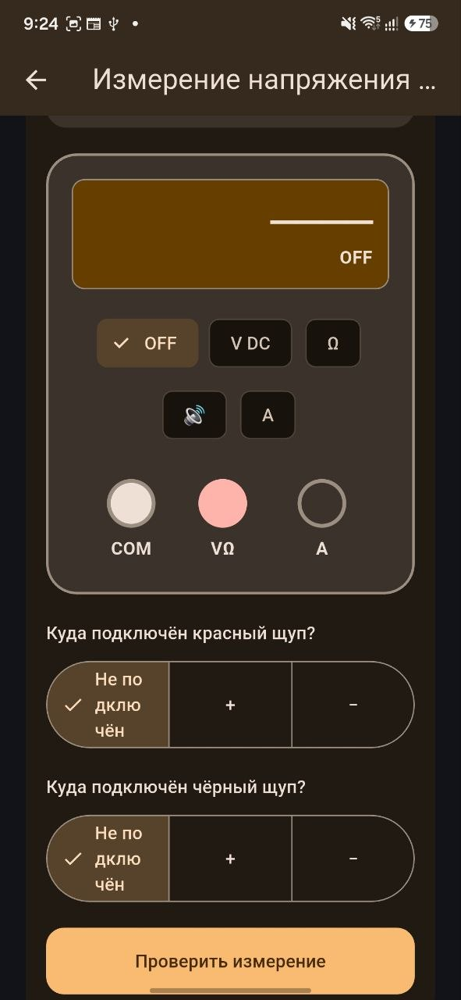

# Автоэлектрика с нуля

**Auto Electrician Learning App** — интерактивное Flutter-приложение для
последовательного изучения автомобильной электрики с начального уровня.
Портфолио-проект для начинающих: теория закрепляется расчётами, измерениями
и диагностикой.

Версия **0.1.0+1** готовится к первому Android portfolio/sideload релизу.
R1–R5 завершены; R6 выполняется. Физический Android smoke R6.6B остаётся
IN PROGRESS; реальные скриншоты добавлены. Итоговое решение о готовности
ещё ожидается. Google Play публикация
не входит в текущий scope.

## Курс и возможности

Курс содержит **3 модуля и 22 урока**:

1. Техника безопасности.
2. Основы электричества.
3. Мультиметр.

Темы: безопасность, напряжение/ток/сопротивление, закон Ома, последовательные
и параллельные цепи, измерения, поиск обрыва и базовая диагностика автомобиля.

Уроки объединяют текст, иллюстрации, предупреждения, вопросы, расчётные
задачи, практические упражнения и итоговые тесты. JSON-контент отделён от
интерфейса и пользовательского прогресса.

Принцип обучения: теория → пример → интерактивное задание → измерение или
диагностика → проверка ответа → закрепление.

### Интерактивные тренажёры

- Электрические цепи: замкнутая/разомкнутая цепь, последовательное и
  параллельное соединение, влияние обрыва на потребителей.
- Виртуальный мультиметр: режимы, входы, подключение щупов и типичные ошибки.
- Измерения: напряжение аккумулятора и обратная полярность, сопротивление
  провода, прозвонка, поиск обрыва и падение напряжения под нагрузкой.
- Измерение тока: выбор режима и входа, ошибки подключения и симуляция
  перегорания предохранителя мультиметра.
- Диагностика: измерения в неисправной цепи, сохранённые результаты и выбор
  диагноза по полученным данным.

Есть светлая и тёмная темы. Узкие компоновки MultimeterBlock и
VoltageDropBlock проверяются при 320/360/412 логических px, включая
увеличенный текст. Владелец подтвердил Android smoke, включая landscape
и увеличенный шрифт, на SM-S931B (Android 17); [результаты](docs/verification/R6_6.md).

## Offline-first и прогресс

Установленный курс работает без интернета, сервера и учётной записи.
SharedPreferences хранит идентификаторы завершённых уроков локально.
Home показывает общий прогресс и следующий незавершённый урок;
список уроков модуля отмечает завершённые уроки.

Для обычного урока нужно правильно выполнить все оцениваемые задания;
для итогового теста — ответить на все задания и набрать заданный проходной
балл. Завершение подтверждается отдельной кнопкой. Попытки и ответы живут
в текущем экране, история попыток и баллов не сохраняется.

Запись completion выполняется последовательно между экземплярами сервиса.
Экран сообщает об ошибке записи и допускает повтор; во время записи
защищается от повторного завершения и пользовательского back.
Ошибки чтения прогресса отображаются с возможностью повторить загрузку.
Прогресс сохраняется после перезапуска приложения.

Android applicationId: `com.dauletserikson.autoelectrician`.
После смены старого development ID `com.example.electrician` его локальный
прогресс автоматически не переносится. Удаление приложения/его данных
удаляет локальный прогресс; облачного восстановления нет.

## Архитектура

`CourseService` загружает bundled JSON в типизированные модели.
`LessonBlock` — sealed-иерархия: неизвестный тип и отсутствие обязательных
данных дают явную parsing/validation ошибку. `LessonBlockRenderer` выбирает
widget по subtype. `LessonScreen` управляет ответами, completion и записью.
Расчёты и диагностические правила вынесены в pure Dart `simulation/`.
В `domain/` находятся оценка попытки и агрегация прогресса курса.
`ProgressService` обслуживает локальный прогресс. Backend и framework
state management отсутствуют.



```text
lib/
  main.dart                  AutoElectricianApp
  models/                    typed content and summary models
  domain/                    lesson attempt, course progress
  simulation/                pure Dart electrical/diagnostic rules
  services/                  CourseService, ProgressService
  screens/                   Home, Course, Module, Lesson
  widgets/lesson_blocks/     interactive block widgets
  widgets/lesson_block_renderer.dart
  theme/                     Material light/dark themes
assets/course/               modules.json, stage_0, stage_1, stage_2
assets/images/               approved educational battery illustration
assets/branding/             approved launcher source artwork
test/                        models, domain, simulation, services, widgets
docs/verification/           completed-task verification records
docs/roadmap/                engineering plans/history
tools/                       launcher resource generation
```

## Технологии и платформы

Flutter, Dart, Material Design, JSON, shared_preferences и flutter_test.
Dart package — `electrician`.

Основной целевой клиент — **Android**. Наличие iOS, macOS, Windows и web
runners не означает проверенную поддержку этих платформ.
Проверенная среда: **Flutter 3.47.5 stable, Dart 3.13.4**.
SDK constraint проекта: `^3.13.4`. Для Android нужны Android SDK и совместимый
JDK; Java/Kotlin компилируются с JVM target 17.

## Запуск и проверки

```bash
git clone https://github.com/DauletSerikson/auto-electrician-learning-app.git
cd auto-electrician-learning-app
flutter pub get
flutter run
```

Выберите подключённое Android-устройство или эмулятор. Перед завершением
изменений:

```bash
dart format lib test
flutter analyze
flutter test
git diff --check
```

Ожидаемый результат анализа — `No issues found!`.
Тесты проверяют parsing/validation, реальные course assets и их
согласованность, domain completion/progress rules, физические модели,
ошибки и concurrency storage, ввод в симуляторах, навигацию/сохранение
экранов, узкие компоновки и полный app smoke путь Home → Course → Module →
реальный урок → completion → обновление прогресса. App smoke использует
widget test и изолированный SharedPreferences platform fake; физическую
Android проверку он не заменяет. Фактические проверки — в
[docs/verification](docs/verification/).

GitHub Actions: один job с Flutter 3.47.5 stable выполняет `flutter pub get`,
`flutter analyze`, `flutter test` при push в main/release/r6-readiness,
pull request и ручном запуске. [Workflow](.github/workflows/flutter.yml).
**CI configured, remote run NOT VERIFIED**: workflow ещё не отправлен на GitHub.
Проект release notes: [v0.1.0](docs/releases/v0.1.0.md).

## Android APK

```bash
flutter build apk --debug
flutter build apk --release
```

Release APK: `build/app/outputs/flutter-apk/app-release.apk`.
Версия: `0.1.0`, versionCode: `1`.

Release-mode APK использует **debug signing** для portfolio/sideload
демонстрации. Это не production-store signing и не заявка на готовность
к Google Play. Keystore/credentials не хранятся в репозитории.

## Скриншоты и демонстрация

Реальные кадры версии 0.1.0+1 с SM-S931B (Android 17), тёмная тема.
Home и список уроков показывают сохранённый прогресс: 1 из 22 уроков.
Измерительные тренажёры показаны в исходном состоянии OFF.

| Home и прогресс | Модули курса | Уроки модуля |
| --- | --- | --- |
|  |  |  |

| Теория и иллюстрация | Вопрос урока | Виртуальный мультиметр |
| --- | --- | --- |
|  |  |  |



Описание кадров и оставшиеся дополнительные снимки:
[docs/screenshots](docs/screenshots/README.md).

## Ограничения

- Симуляторы — специализированные учебные модели, не универсальный solver.
- Приложение не заменяет документацию конкретного автомобиля и
  профессиональное диагностическое оборудование.
- Нет авторизации, синхронизации, analytics, истории попыток/баллов,
  unlocking и сохранения текущей quiz session после выхода.
- R6.6B IN PROGRESS; окончательный release audit ещё не выполнен; TalkBack не проверен.
- Продвинутый accessibility audit и другие платформы ещё не проверены.

## Развитие проекта

Завершённые этапы: R1 stabilization, R2 typed lesson blocks,
R3 simulator/domain separation, R4 simulator correctness,
R5 progress reliability/domain rules. R6 выполняет подготовку портфолио:
layouts, identity, branding, provenance, документация, smoke и CI.
Планы сохранены в [docs/roadmap](docs/roadmap/) как история разработки;
они не являются пользовательским руководством.

Возможные будущие задачи: прогресс модулей, история попыток/баллов,
локализация, новые разделы курса и проверка дополнительных платформ.
Сроки реализации не назначены.

## Лицензия и artwork

Код и документация — [MIT](LICENSE), copyright 2026 Daulet Serikson.
Утверждённые владельцем launcher и battery artwork сгенерированы специально
для проекта с помощью OpenAI image generation. По заявлению владельца,
сторонние исходные изображения и логотипы не использовались.
Происхождение: [launcher](assets/branding/README.md),
[battery](assets/images/README.md). Исключительные права на AI-generated
artwork не заявляются; MIT не служит гарантией таких прав.
Dependencies распространяются по своим лицензиям.

## Автор

**Daulet Serikson** · GitHub: [DauletSerikson](https://github.com/DauletSerikson)
